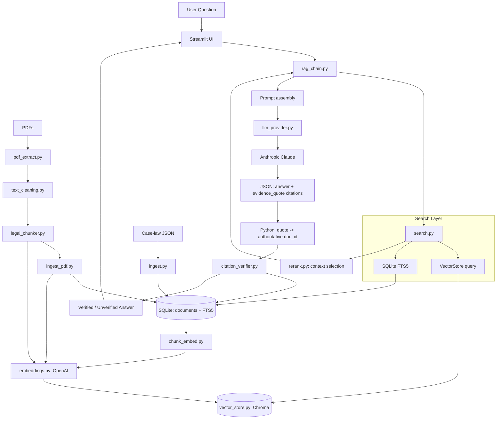

# IndianLawGPT V3 Architecture

## V4 additions — HTTP API and web frontend

- `src/api.py` (FastAPI) is the only way the web frontend reaches the pipeline. `POST /api/research`
  streams Server-Sent Events: a `stage` event as each real step starts/finishes (semantic search,
  keyword search, ranking, drafting, verification — reported by `search.hybrid_search` and
  `rag_chain.answer_question` via an `on_stage` callback), then one `result`. Other endpoints:
  `/api/search` (retrieval only, filtered by source type), `/api/documents/{doc_id}` (full text,
  highlight offsets for cited quotes, old↔new correspondences), `/api/acts/{act_id}/sections`,
  `/api/law-map`, `/api/law-map/acts`, `/api/stats`. It decodes HTML entities in scraped text for
  display only; stored text and embeddings are untouched.
- Answers are Markdown with inline `[n]` markers. `rag_chain` maps each evidence quote to its retrieved
  passage, renumbers markers to the verified sources, and drops any marker whose quote matched nothing.
- Structured output uses Claude tool calling (`ChatAnthropic.with_structured_output`) with `citations`
  before `answer` in the schema. Prompt-only JSON broke once answers became long Markdown (the model
  returned plain Markdown, or wrote citations inside the answer string). `llm_provider` also decodes
  citations the model sends as a string (plain JSON, `<parameter>`-wrapped JSON, or `<citation>` XML).
- Statute metadata now includes `corresponds_to` (published IPC↔BNS, CrPC↔BNSS, IEA↔BSA and Income-tax
  1961↔2025 section correspondences), backfilled via `ingest_statutes.py --metadata-only`.
- Keyword search is ranked by BM25; the Chroma client initialises under a lock (concurrent first
  requests raced inside Chroma's shared client cache).
- `frontend/` — Vite + React + TypeScript + Tailwind v4. Routes: `/` (research entry), `/research/:id`
  (analysis + evidence rail), `/source/:docId` (reader with highlighted passages), `/search`,
  `/compare` (old → new law, side by side with a word diff). Research history lives in localStorage.

## System Flow Diagram

## Major Architectural Changes (V3)

1. **Provider abstraction**: `embeddings.py`, `llm_provider.py`, and `vector_store.py` each
   expose a small interface + a `get_*()` factory driven by `config.py` / env vars
   (`EMBEDDING_PROVIDER`, `LLM_PROVIDER`, `VECTOR_DB_PROVIDER`). Swapping a provider is a new
   class + one branch in a factory function — no changes anywhere else.
2. **OpenAI embeddings**: replaces the local `sentence-transformers/all-MiniLM-L6-v2` model.
   The Chroma collection now explicitly uses cosine distance (`hnsw:space: cosine`) so the
   `1 - distance` similarity-score math stays meaningful. **Existing vectors from the old
   embedding model are not compatible and must be rebuilt.**
3. **Anthropic Claude generation**: replaces Groq/Ollama, using the same
   `langchain_anthropic.ChatAnthropic` client as the sibling Health Coach AI project. V3 obtained
   structured output (answer + evidence-quote citations) from prompt-instructed JSON; V4 switched
   to tool calling (see "V4 additions" above) after prompt-only JSON proved unreliable for long
   Markdown answers.
4. **PDF ingestion pipeline**: `pdf_extract.py` (per-page text extraction) →
   `text_cleaning.py` (header/footer/hyphenation cleanup) → `legal_chunker.py`
   (heading-aware chunking, shared with the case-law path) → `ingest_pdf.py` (orchestration,
   idempotent by content hash, page-number-aware chunk metadata).
5. **Generalized `documents` table**: SQLite's `cases` table became `documents`, with a
   `source_type` column (`case_law` | `pdf` | ...) so case-law JSON and PDFs share one table,
   one FTS index, and one citation-verification code path.
6. **Kanoon API dependency removed**: `kanoon_client.py` and `fetch_judgments.py` are deleted.
   PDFs you provide are now the primary data source; the existing 194 scraped judgments remain
   as valid case-law data, ingested via the same JSON path as before.
7. **Reranking / context selection**: `rerank.py` combines semantic score with a lightweight
   lexical-overlap signal and caps chunks-per-document, so retrieval doesn't hand the LLM
   several chunks from one document at the expense of diversity.
8. **Improved hybrid retrieval**: keyword-only hits previously carried empty `text` and could
   never actually be cited (a latent gap in V2) — they now pull the document's stored
   `full_text` so a keyword match contributes real, citable content.
9. **Evaluation harness**: `evaluate_rag.py` runs a fixed question set end-to-end and reports
   citation-verification health (a regression guard, not a legal-correctness grader).

## Major Module Responsibilities

- `src/config.py`: Central, env-driven settings for every provider and tunable.
- `src/logging_config.py`: Structured logging (`LOG_LEVEL` env var).
- `src/db.py`: SQLite connection, schema (`documents`, `citations`, `feedback`), FTS5 logic.
- `src/init_db.py`: One-off script to create the SQLite DB.
- `src/pdf_extract.py`: Per-page PDF text extraction (pypdf).
- `src/text_cleaning.py`: De-hyphenation, whitespace normalization, repeated header/footer stripping.
- `src/legal_chunker.py`: Structure-aware chunking shared by case-law and PDF ingestion.
- `src/ingest.py`: Inserts case-law JSON files into SQLite (`source_type='case_law'`).
- `src/ingest_pdf.py`: Full PDF pipeline — extract, clean, chunk, embed, index (`source_type='pdf'`).
- `src/chunk_embed.py`: Embeds/indexes case-law documents already in SQLite into the vector store.
- `src/embeddings.py`: OpenAI embedding provider (swappable).
- `src/vector_store.py`: Chroma vector store (swappable).
- `src/llm_provider.py`: Anthropic Claude provider (swappable).
- `src/search.py`: Hybrid retrieval (vector store + SQLite FTS5), no UI framework dependency.
- `src/rerank.py`: Context selection / reranking pass between retrieval and prompt assembly.
- `src/rag_chain.py`: Orchestrates retrieval, prompt assembly, LLM call, deterministic citation mapping.
- `src/citation_verifier.py`: Parses `[SOURCE: doc_id]` tokens, verifies each against SQLite.
- `src/evaluate_rag.py`: Evaluation harness over `data/eval/eval_questions.json`.
- `src/app.py`: Streamlit frontend (temporary POC UI — not redesigned in this pass).
